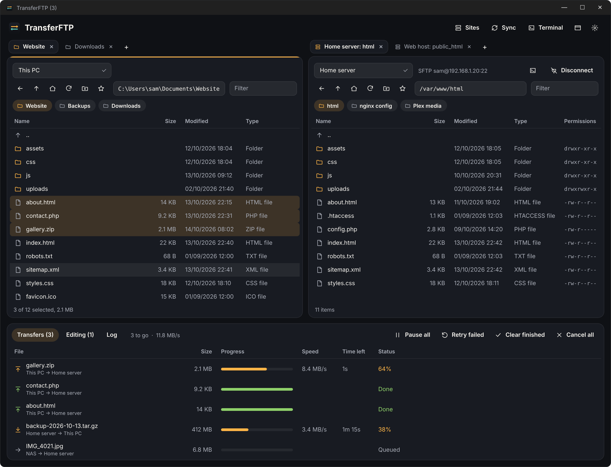
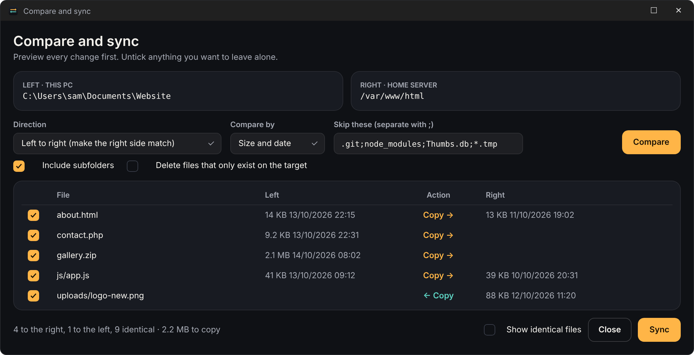
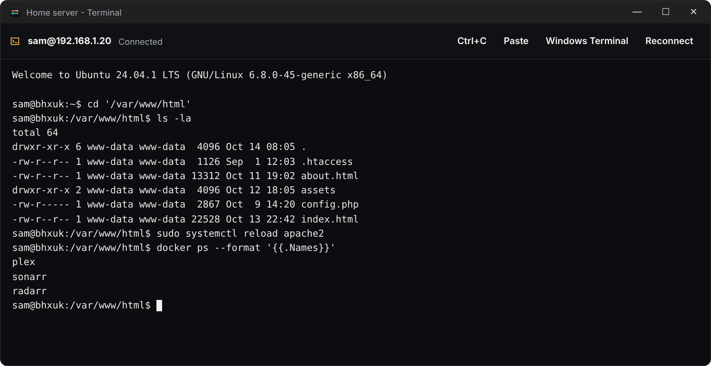

<div align="center">


# TransferFTP

**Move files anywhere: your PC, your servers, your network shares.**

A two-pane file transfer client for Windows 10 and 11. SFTP, SCP, FTP, FTPS and network shares,
with folder sync you can preview, edit-and-save-back, server-to-server copies and a built-in SSH terminal.

**[Download TransferFTP for Windows](https://github.com/bhxuk/TransferFTP/releases/latest/download/TransferFTP-Setup.exe)**  ·  [Website](https://bhxuk.github.io/TransferFTP/)  ·  [User guide](docs/USER-GUIDE.md)  ·  [What's new](CHANGELOG.md)



</div>

---

## What it does

| | |
|---|---|
| **Two panes, with tabs** | Any place on either side: This PC, a saved site, or a network share. Open as many tabs as you like on each side, or a whole new window. Drag between them, or press F5 to copy and F6 to move. |
| **Quick links** | Save folders you use a lot, on your PC or any server, and jump back with one click. Recent folders are a click away too. |
| **Every protocol you need** | SFTP and SCP (password or key, including PuTTY keys), FTP, FTPS explicit and implicit, and Windows or NAS shares (SMB). |
| **Server to server** | Drag from one server straight to another. Files stream through your PC, no temporary copies. |
| **A proper queue** | Several files at once, live speed and time left, pause and resume, automatic retry when the connection drops, and resume of half-finished files. |
| **Sync with preview** | Compare two folders and see every copy and delete before anything happens. One way, the other way, or newest wins. Skip lists like `.git;node_modules`. |
| **Edit and save back** | Double-click a file on a server, edit it in your usual editor, and every save uploads automatically. |
| **SSH terminal** | A terminal window for any SFTP or SCP site, opening in the folder you're looking at. One click hands off to Windows Terminal for vim or htop. |
| **Safe by default** | Passwords are encrypted with Windows (DPAPI), server keys are checked and remembered, certificate problems are shown before you trust them. |

Also: permissions (chmod) with tick boxes, filter as you type, natural sorting, back and up history, import from FileZilla, light and dark themes with six accent colours.

## A quick look

### Compare and sync

Choose a direction, press Compare, untick anything you want left alone, then Sync. Nothing changes until you press it.



### SSH terminal

Opens in the folder you have open. Ctrl+C stops a command, right-click pastes.



## Install

1. Download **[TransferFTP-Setup.exe](https://github.com/bhxuk/TransferFTP/releases/latest/download/TransferFTP-Setup.exe)**.
2. Double-click it. No admin rights needed, it installs just for you.
3. Windows may say "Windows protected your PC" because the installer isn't code-signed. Click **More info**, then **Run anyway**.

Needs Windows 10 (version 2004 or later) or Windows 11, 64-bit. Everything it needs is inside the installer.

## Keyboard

| Key | Does |
|---|---|
| F5 / F6 | Copy / move the selection to the other side |
| F2 / F7 / Del | Rename / new folder / delete |
| F4 or Enter | Edit a remote file (Enter opens folders) |
| Backspace, Alt+Left | Up a folder, back |
| Tab | Switch sides |
| Ctrl+L, Ctrl+F, Ctrl+R | Path box, filter, refresh |
| Ctrl+T, Ctrl+W, Ctrl+Tab | New tab, close tab, next tab |
| Ctrl+N | New window |
| Ctrl+D | Add this folder to quick links |
| Ctrl+S, F9 | Sites, terminal |

## Where things are kept

Settings, saved sites and trusted server keys live in `%AppData%\TransferFTP`. Passwords in `sites.json` are encrypted for your Windows account, so they can't be read on another PC or by another user. Site exports never include passwords.

Passwords can be saved for every site type. Plain FTP sends them over the network unencrypted, so TransferFTP warns you before saving one for an FTP site, then saves it if you carry on. Use FTPS where the server supports it.

## Build it yourself

```
dotnet publish src/TransferFTP/TransferFTP.csproj -c Release -r win-x64 --self-contained true -p:PublishSingleFile=true -o publish
iscc /DMyAppVersion=1.0.0 /DPublishDir=..\publish installer\TransferFTP.iss
```

Needs the .NET 8 SDK and Inno Setup 6. Every push to `main` builds on GitHub Actions, and a new version number publishes a release with `TransferFTP-Setup.exe`.

Built with [SSH.NET](https://github.com/sshnet/SSH.NET) and [FluentFTP](https://github.com/robinrodricks/FluentFTP).

## Licence

MIT
